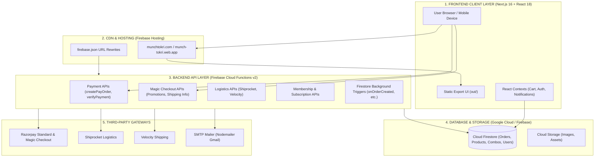

# 🏛️ Munch Tokri — Enterprise System Architecture & Folder Organization

This document details the complete end-to-end architecture, folder structures, and separation of concerns for the **Munch Tokri** e-commerce platform. It is structured according to senior principal engineering standards (10+ years industry practice), ensuring clear separation between **Frontend (Client UI/UX)**, **Backend (Cloud Functions & APIs)**, **Database (Firestore)**, and **Environment Configurations**.

---

## 📌 1. High-Level System Architecture



---

## 📁 2. Repository Directory Structure

```text
hurigalu_angadi_website/
├── .env.example                     <-- Frontend environment template (NEXT_PUBLIC_*)
├── .env.local                       <-- Local frontend active variables (git-ignored)
├── firebase.json                    <-- Hosting routing, rewrites & deployment config
├── firestore.rules                  <-- Firestore database security rules
├── firestore.indexes.json           <-- Database query indexes
├── storage.rules                    <-- Cloud Storage access security rules
├── next.config.mjs                  <-- Next.js build configuration (output: 'export')
├── package.json                     <-- Root dependencies and deployment scripts
├── tsconfig.json                    <-- Frontend TypeScript compiler settings
│
├── public/                          <-- Static public assets (images, SVGs, videos)
│   ├── logo.png / logo.svg          <-- Brand identity assets
│   ├── razorpay.svg                 <-- Payment trust badges
│   ├── herovideo.mp4 / .webm        <-- Hero background videos
│   └── images/                      <-- Static product graphics
│
├── src/                             <-- FRONTEND APPLICATION ROOT
│   ├── app/                         <-- Next.js 16 App Router (Pages & Routes)
│   │   ├── (public)/                <-- Customer-Facing Storefront Pages
│   │   │   ├── page.tsx             <-- Homepage
│   │   │   ├── shop/                <-- Product listing & category filters
│   │   │   ├── product/[id]/        <-- Dynamic Product Details Page + 1-Click Widget
│   │   │   ├── combos/              <-- Combo packs listing
│   │   │   ├── combos/[id]/         <-- Dynamic Combo Details Page + Pack Selector
│   │   │   ├── build-mixture/       <-- Custom Mixture Builder Tool
│   │   │   ├── checkout/            <-- Standard 4-step + Direct Magic Checkout
│   │   │   ├── membership/          <-- Tokri Club VIP Membership program
│   │   │   ├── dashboard/           <-- Customer Account & Order Tracking
│   │   │   ├── login/               <-- Customer Phone/Email/Google Authentication
│   │   │   └── (legal)/             <-- Privacy, Shipping, Refund, Terms, About, Contact
│   │   ├── admin/                   <-- Merchant Admin Portal
│   │   │   ├── (authenticated)/     <-- Protected Admin Routes (Orders, Inventory, Combos, etc.)
│   │   │   └── login/               <-- Admin Secret Sign-in
│   │   ├── layout.tsx               <-- Root Layout (Meta Pixel, SEO, Analytics, Fonts)
│   │   └── globals.css              <-- Design system tokens, variables & typography
│   │
│   ├── components/                  <-- REUSABLE UI COMPONENTS
│   │   ├── ui/                      <-- Atomic Design Components
│   │   │   ├── Button/              <-- Standard Buttons (primary, outline, ghost)
│   │   │   ├── Card/                <-- ProductCard with live inventory & stock pills
│   │   │   ├── Cart/                <-- CartDrawer (slide-out cart + 1-click buy)
│   │   │   ├── FloatingCart/        <-- Floating badge (SSR hydration-safe)
│   │   │   ├── RazorpayMagicCheckoutWidget/ <-- 1-Click Buyer Protection badge & black button
│   │   │   ├── Review/              <-- Customer reviews form and list
│   │   │   └── StarRating/          <-- Interactive star rating visualizer
│   │   ├── layout/                  <-- Structural UI Components
│   │   │   ├── Navbar/              <-- Responsive Top Header + Cart Counter
│   │   │   ├── Footer/              <-- Global Footer with links and trust marks
│   │   │   └── AnnouncementBar/     <-- Top ticker announcement banner
│   │   ├── providers/               <-- Context Provider wrappers
│   │   └── ErrorBoundary.tsx        <-- React Crash Fallback Boundary
│   │
│   ├── contexts/                    <-- CLIENT STATE MANAGEMENT (React Contexts)
│   │   ├── CartContext.tsx          <-- Cart items, quantities, totals, localStorage persistence
│   │   ├── FirebaseContext.tsx      <-- Firebase Auth state, user session, login/logout
│   │   ├── NotificationContext.tsx  <-- Custom in-app toasts & alerts
│   │   └── AdminContext.tsx         <-- Admin RBAC and session protection
│   │
│   ├── hooks/                       <-- CUSTOM REACT HOOKS
│   │   └── useFirestore.ts          <-- Real-time Firestore hooks (useOrders, useMembership, etc.)
│   │
│   ├── lib/                         <-- FRONTEND BUSINESS LOGIC & UTILITIES
│   │   ├── constants.ts             <-- Single source of truth (Shipping rates, thresholds, taxes)
│   │   ├── firebase.ts              <-- Firebase Client SDK initialization
│   │   ├── email-utils.ts           <-- Email validation and formatting helpers
│   │   ├── image-utils.ts           <-- Image fallback and placeholder helpers
│   │   └── analytics/               <-- Client event tracker (tracker.ts)
│   │
│   └── types/                       <-- TYPESCRIPT DATA DEFINITIONS
│       ├── index.ts                 <-- Product, Order, User, Combo, Coupon, Variant models
│       └── analytics.ts             <-- Analytics event schemas
│
└── functions/                       <-- BACKEND MICROSERVICES (Firebase Cloud Functions v2)
    ├── .env.example                 <-- Backend server secrets template
    ├── .env                         <-- Private server credentials (git-ignored)
    ├── package.json                 <-- Backend dependencies (Razorpay, Shiprocket, jsPDF, etc.)
    ├── tsconfig.json                <-- TypeScript compilation to ES2022
    └── src/
        └── index.ts                 <-- Central Cloud Functions registry (17 services)
```

---

## 💻 3. Frontend Architecture (`src/`)

### A. Routing Pattern (Next.js App Router)
* **`(public)` Route Group**: Pages accessible by shoppers without authentication restrictions.
* **`admin` Route Group**: Dedicated administrative workspace with Role-Based Access Control (RBAC).
* **Static Export (`output: 'export'`)**: Next.js pre-compiles all pages into static HTML/CSS/JS in `out/`. This guarantees **sub-second page loads**, zero server render delays, and low hosting costs.

### B. State Management Separation
* **Cart State (`CartContext.tsx`)**: Manages shopping bag items, variant grams calculations, and syncs automatically with `localStorage` under `munchtokri_cart`. Includes client-side hydration guards to eliminate SSR mismatch errors.
* **Auth State (`FirebaseContext.tsx`)**: Tracks Firebase Auth session (`onAuthStateChanged`), customer profile, and saved delivery addresses.
* **Business Constants (`src/lib/constants.ts`)**: Central single source of truth for:
  - `SHIPPING_FREE_THRESHOLD = 350` (Orders $\ge$ ₹350 get free delivery)
  - `SHIPPING_RATE = 50` (Flat ₹50 for smaller orders)
  - `TAX_RATE = 0.05` (5% GST calculation)

---

## ⚡ 4. Backend Architecture (`functions/src/index.ts`)

The backend runs as **serverless microservices** on Google Cloud via Firebase Functions v2 (`asia-south1` region). All 17 endpoints operate independently:

| Category | Function Name | Trigger / Type | Description |
| :--- | :--- | :--- | :--- |
| **Payment** | `createPayOrder` | HTTPS Callable (`onCall`) | Initializes secure Razorpay orders in paise. |
| **Payment** | `verifyPayment` | HTTPS Callable (`onCall`) | Validates HMAC-SHA256 signature before saving orders. |
| **Payment** | `razorpayWebhook` | HTTPS (`onRequest`) | Listens for `order.paid` and `payment.captured` events. |
| **Magic 1-Click** | `magicCheckoutPromotions` | HTTPS (`onRequest`) | Returns active store coupons to the Magic modal. |
| **Magic 1-Click** | `magicCheckoutApplyPromotion`| HTTPS (`onRequest`) | Validates and calculates discount on coupon entry. |
| **Magic 1-Click** | `magicCheckoutShippingInfo` | HTTPS (`onRequest`) | Real-time PIN code serviceability and ₹50 / Free shipping logic. |
| **Logistics** | `createShiprocketOrder` | HTTPS Callable (`onCall`) | Auto-creates pickup and manifests in Shiprocket. |
| **Logistics** | `createVelocityOrder` | HTTPS Callable (`onCall`) | Pushes custom orders to Velocity shipping API. |
| **Logistics** | `shiprocketWebhook` | HTTPS (`onRequest`) | Receives live tracking and status updates from courier. |
| **Orders** | `onOrderCreated` | Firestore Trigger | Auto-generates PDF tax invoices & sends confirmation email. |
| **Orders** | `onOrderStatusUpdated` | Firestore Trigger | Sends email notifications on dispatch/delivery. |
| **Coupons** | `validateCoupon` | HTTPS Callable (`onCall`) | Validates discount rules, usage limits, and expiry. |
| **Membership** | `membershipStatus` | HTTPS (`onRequest`) | Checks active VIP Tokri Club benefits. |
| **Membership** | `createSubscription` | HTTPS (`onRequest`) | Creates recurring billing mandate via Razorpay. |
| **Membership** | `cancelSubscription` | HTTPS (`onRequest`) | Cancels active membership subscriptions. |
| **Membership** | `checkMembershipExpiry` | Cloud Scheduler (Cron) | Runs every 24 hours to expire lapsed memberships. |
| **Membership** | `syncMembershipToCustomer`| Firestore Trigger | Syncs membership tier changes into customer profiles. |

---

## 🔐 5. Environment & Secrets Management

To maintain enterprise security, configurations are strictly divided between **Client** and **Server**:

### Client (`.env.local` / `.env.example`)
* Only contains public variables prefixed with `NEXT_PUBLIC_`.
* Safe to be embedded in browser JavaScript bundles (e.g. Firebase API Key, Razorpay Key ID, Measurement ID).

### Server (`functions/.env` / `functions/.env.example`)
* Contains confidential API keys and credentials that must **never** be exposed to the browser.
* Includes: `RAZORPAY_KEY_SECRET`, `EMAIL_PASS`, `SHIPROCKET_PASSWORD`, `VELOCITY_API_KEY`.

---

## 🚀 6. Developer Workflow & Commands

| Task | Command | Description |
| :--- | :--- | :--- |
| **Local Development** | `npm run dev` | Starts local Next.js development server at `localhost:3000`. |
| **Production Build** | `npm run build` | Cleans `out/` and compiles an optimized static export. |
| **Deploy Website** | `npm run deploy:hosting` | Builds and deploys the static storefront to `munchtokri.com`. |
| **Deploy Backend** | `npm run deploy:functions`| Lints, builds TypeScript, and deploys all 17 Cloud Functions. |
| **Deploy Everything** | `npm run deploy` | Full multi-service deployment with 4GB Node memory headroom. |
